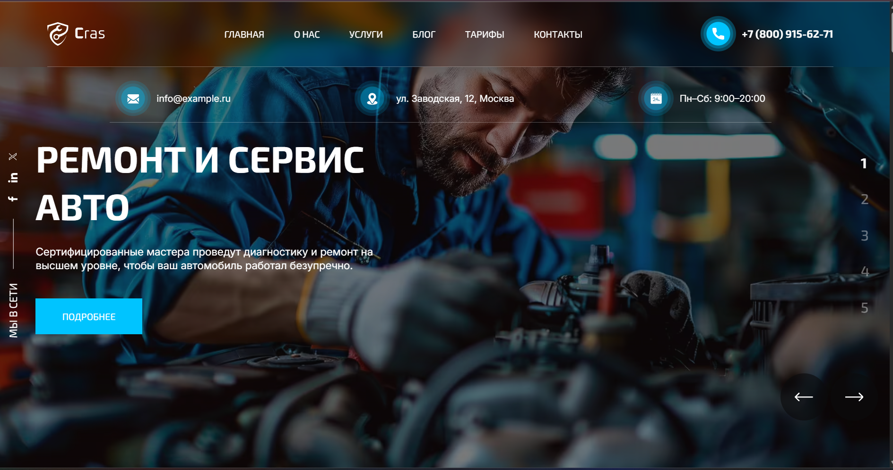

# Cras: сайт автосервиса

Учебный проект для портфолио: многостраничный адаптивный сайт автосервиса. Вёрстка выполнена по макету из Figma, написана вручную (HTML, SCSS, JavaScript) и собирается через Gulp.

🔗 **Демо:** [drozdtatsiana.github.io/CRAS](https://drozdtatsiana.github.io/CRAS/)


## Что есть на сайте

- **Главная страница:** слайдер с услугами, преимущества, услуги, видео, статистика, отзывы (слайдер), команда, тарифы, блог, футер.
- **Страницы услуг:** общая страница «Все услуги» и отдельные страницы: ремонт и сервис, компьютерная диагностика, детейлинг, шиномонтаж, кузовной ремонт и покраска, тюнинг, диагностика и ремонт двигателя.
- **Страница «Почему выбирают нас».**
- **Блог:** три статьи.
- **Модальное окно** на нативном `<dialog>`: заказ тарифа, запись на обслуживание и вызов механика (из футера). Закрывается по Esc, клику на фон и кнопкам.
- **Адаптивная вёрстка** от 1920 до 340 px, бургер-меню.
- **Изображения** в форматах AVIF и WebP с запасным JPG/PNG (`<picture>`).

## Технологии

- HTML5, семантическая разметка, методология БЭМ
- SCSS: модули `@use`, переменные, медиа-запросы в отдельном файле
- JavaScript (ES6+)
- [Swiper](https://swiperjs.com/) для слайдеров
- Gulp 4: сборка стилей, скриптов, страниц, SVG-спрайта и изображений
- BrowserSync: живая перезагрузка
- sharp: уменьшение тяжёлых исходных фотографий

## Запуск проекта

Нужен [Node.js](https://nodejs.org/) и установленный Gulp.

```bash
npm install
gulp
```

Сайт откроется на `http://localhost:3000`.

Сборка для публикации:

```bash
gulp build
```

Если исходные картинки слишком тяжёлые, перед запуском их можно уменьшить:

```bash
node resize-images.mjs
```

## Публикация

Сайт опубликован на GitHub Pages из ветки `gh-pages`: туда отправляется содержимое папки `dist` после `gulp build`.

## Структура проекта

```
app/
├── components/   # общие части страниц: head, header, footer, script
├── pages/        # исходные HTML-страницы (собираются в app/)
├── scss/         # стили: style.scss, _media.scss, _vars.scss и другие
├── js/           # main.js (на выходе main.min.js)
├── images/
│   ├── src/      # исходные изображения
│   └── sprite/   # SVG-иконки для спрайта
└── video/
gulpfile.js
resize-images.mjs
```

Страницы собираются из компонентов через `gulp-include`: например, шапка и футер лежат в `app/components` и подставляются на все страницы. Править нужно файлы в `app/pages`, а не готовые HTML в папке `app`.

## Источники

- Макет: шаблон Cras с Envato Elements, доработан для учебного проекта.
- Фотографии: [Magnific](https://www.magnific.com).

## Автор

Татьяна, выпускница курса по HTML/CSS.

- GitHub: [drozdtatsiana](https://github.com/drozdtatsiana)
